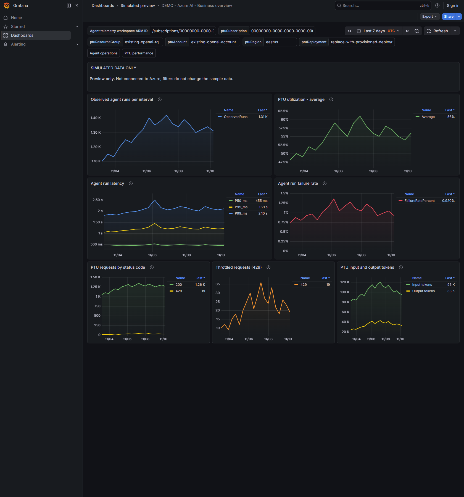
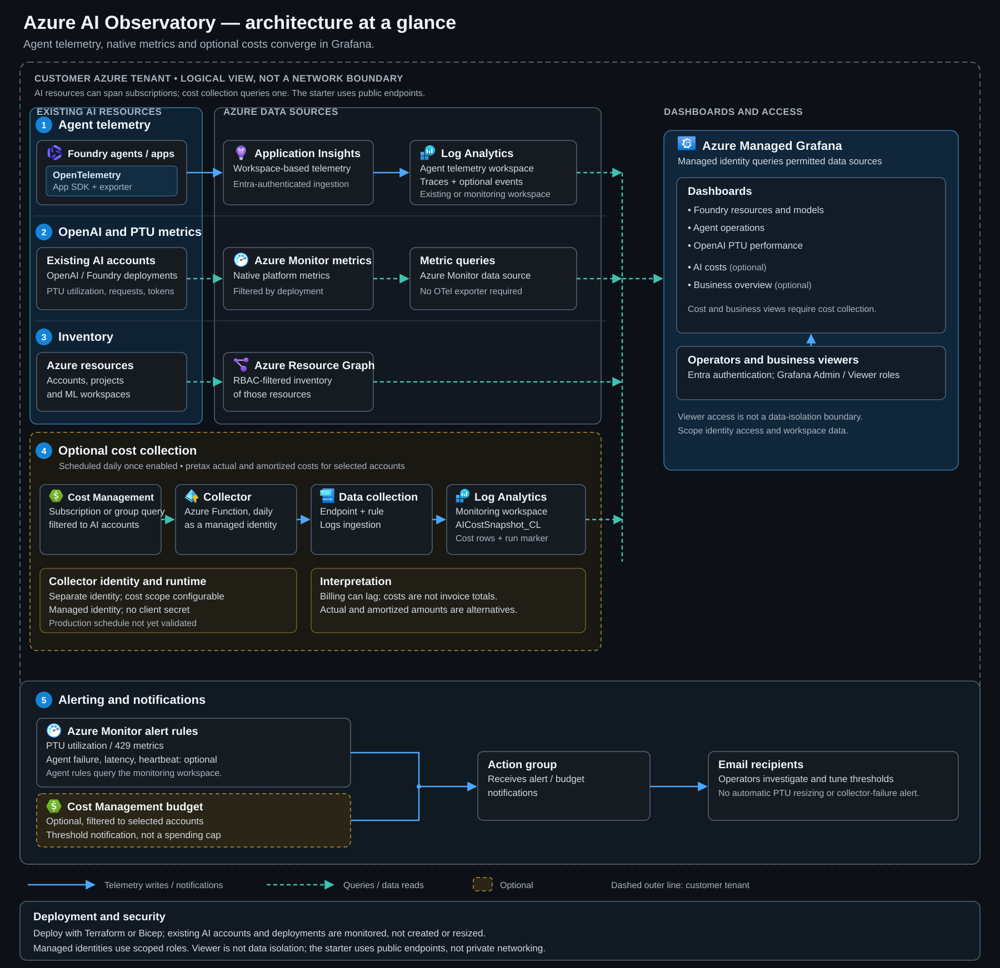

# Azure AI Observatory

**Foundry agents · OpenAI PTUs · Cost visibility**

Monitor existing **Microsoft Foundry** and **Azure OpenAI provisioned throughput (PTUs)** with separate dashboards backed by Azure Managed Grafana, Azure Monitor, and Application Insights / Log Analytics.

**Choose your deployment:** [Terraform](#deploy-with-terraform) · [Bicep](#deploy-with-bicep)

New to Azure or this repository? Start with the [step-by-step deployment guide](docs/getting-started.md).

## Dashboards

### Foundry agent operations


### Azure OpenAI PTU performance


### Business overview



## Architecture



[View full size](docs/images/azure-observability-architecture-dark.svg) · [Architecture and data flows](docs/architecture.md)

## Deploy to Azure

Choose **Terraform or Bicep**. Both deploy Azure monitoring resources, roles, alerts, a Grafana data source, and dashboards. Both support an optional Business overview dashboard (agent and PTU signals, no cost data) and two opt-in billed-cost routes. Neither path requires Python to deploy. Use one tool per deployment; the paths do not share state or ownership.

**Before deploying:** have Azure CLI, an Azure identity allowed to create resources and assign roles, existing account details and regions, PTU deployment names, a Grafana admin object ID, and an alert email. The Bicep path uses PowerShell 7 and Azure CLI for Grafana's data-plane API.

The commands below show an interactive deployer login. Grafana reads Azure Monitor, Log Analytics and Resource Graph with its **managed identity**, so Foundry, PTU and agent-trace dashboards need no secret or GitHub. Billed cost is the one exception: no tested Grafana data source can query Cost Management or a private storage account with that identity directly. The baseline is the Azure portal and an optional budget alert, and there are two opt-in routes into Grafana. The [export route](docs/costs.md#cost-management-export-to-azure-data-explorer) exports cost to private storage that Azure Data Explorer reads, and Grafana queries ADX, all by managed identity with no code or secret, at the price of a continuously billed ADX cluster. The cheaper and simpler [Infinity route](docs/costs.md#direct-cost-management-queries-with-infinity-opt-in) has Grafana query Cost Management directly with no added resources, but it is **not secretless**: it needs a service principal whose client secret Grafana stores and you rotate. Neither route gives per-viewer cost authorization.

### Deploy with Terraform

Install Terraform 1.7+ and configure protected, locked remote Terraform state for real environments; state can contain sensitive values. Remote state is not configured automatically: follow the [state setup walkthrough](docs/getting-started.md#prepare-remote-state-for-terraform) before initializing either stage. The [Terraform guide](docs/terraform.md) covers both stages and access requirements.

**1. Create Azure monitoring resources**

Copy `terraform/azure/example.tfvars.example` to `terraform/azure/local.tfvars` and replace its placeholders. If you enable an opt-in cost route (`enable_cost_infinity` or `enable_cost_export`), review its permissions in the [cost guide](docs/costs.md) first. If PTU metric support is not yet confirmed, set `enable_ptu_alerts = false` initially; enable it after [metric discovery](docs/setup.md#metric-discovery).

```powershell
az login
az account set --subscription "<subscription-id>"
terraform -chdir=terraform\azure init
terraform -chdir=terraform\azure plan -var-file=local.tfvars
# Review the plan and expected Azure charges before applying:
terraform -chdir=terraform\azure apply -var-file=local.tfvars
terraform -chdir=terraform\azure output
```

**2. Deploy and configure Grafana dashboards**

Copy `terraform/grafana/example.tfvars.example` to `terraform/grafana/local.tfvars`. Fill in `grafana_endpoint` and `dashboard_defaults.monitoring_workspace_resource_id` from the Azure outputs, plus the real subscription, Foundry account, and PTU account/deployment. Set `enable_business_overview = true` to also provision the Business overview dashboard; it needs only the agent telemetry workspace. If agent telemetry already lives in another workspace, set `telemetry_workspace_resource_id` and grant Grafana access as described in the [deployment guide](docs/terraform.md#2-configure-the-grafana-stage).

After the Grafana Admin role has propagated, use the same signed-in identity to apply the second stage:

```powershell
$env:GRAFANA_AUTH = az account get-access-token --resource https://dashboard.azure.com --query accessToken -o tsv
if ($LASTEXITCODE -ne 0 -or -not $env:GRAFANA_AUTH) { throw "Could not obtain a Grafana Entra token" }
terraform -chdir=terraform\grafana init
terraform -chdir=terraform\grafana plan -var-file=local.tfvars
# Review the plan before applying:
terraform -chdir=terraform\grafana apply -var-file=local.tfvars
terraform -chdir=terraform\grafana output dashboard_urls
Remove-Item Env:\GRAFANA_AUTH
```

### Deploy with Bicep

Install Azure CLI with Bicep and PowerShell 7. Copy `infra/main.example.bicepparam` to `infra/main.local.bicepparam` and replace its placeholders. Add `param enablePtuAlerts = false` until you have verified the metrics. If you enable an opt-in cost route (`enableCostInfinity` or `enableCostExport`), review its permissions in the [cost guide](docs/costs.md) first. Use real account regions and deployment names in the dashboard defaults.

```powershell
az login
az account set --subscription "<subscription-id>"
# Create the monitoring resource group first, if it does not exist:
az group create --name "<monitoring-rg>" --location "<region>"
pwsh -NoProfile -File .\scripts\deploy_bicep.ps1 -SubscriptionId "<subscription-id>" -ResourceGroup "<monitoring-rg>" -ParametersFile .\infra\main.local.bicepparam -WhatIf
# Review the what-if output and expected Azure charges before deploying:
pwsh -NoProfile -File .\scripts\deploy_bicep.ps1 -SubscriptionId "<subscription-id>" -ResourceGroup "<monitoring-rg>" -ParametersFile .\infra\main.local.bicepparam
```

The helper deploys the Bicep template and configures Grafana using a short-lived Entra token. See the [Bicep guide](docs/bicep.md) for permissions, dashboard defaults, reruns, and the important difference between disabling a feature and deleting its Azure resources.

Existing Foundry/OpenAI accounts and deployments are monitored, not created or resized. Agent charts require real instrumented telemetry; where billed cost is enabled, billing data can lag. Both paths can grant an Entra group read-only Grafana Viewer access, which is **not a data-isolation boundary**. See [business-user access](docs/terraform.md#business-user-access) and [cost interpretation](docs/costs.md).

## What is included

| Area | Included | Prerequisite / boundary |
| --- | --- | --- |
| Foundry estate | Accessible accounts, projects, and ML workspace inventory | Resource Graph returns only resources visible to the Grafana identity |
| Foundry agents | Run latency percentiles, failures, tool performance, token usage, trace IDs, observed telemetry counts | Application Insights instrumentation matching the documented contract |
| Foundry model usage | OpenAI requests and inference tokens on a selected Foundry account | OpenAI-specific metrics; not a universal endpoint for all Foundry model providers |
| Estimated token cost | Per-model table of tokens × list price on the Foundry overview, with no secret | An estimate, not billed cost: prices are a table you maintain in `queries/model-prices.kql`, prompt caching overstates input, and PTU, batch, regional and negotiated pricing are not covered. See [cost interpretation](docs/costs.md#native-estimate-from-azure-monitor-metrics-no-secret) |
| Billed cost, export (opt-in) | A Cost Management export to private storage, read by Azure Data Explorer and queried by Grafana, all by managed identity, with the `azure-ai-costs-native` dashboard | Adds an ADX cluster that bills continuously (roughly $95 per month at retail). The export holds the whole subscription's cost rows, and data starts at deployment. Live-validated with Bicep, apart from a scheduled run and month rollover; Terraform is not live-validated. Optionally, Grafana can reach ADX over a managed private endpoint with the cluster's public access disabled (Bicep live-validated; needs an approval script). See [export to ADX](docs/costs.md#cost-management-export-to-azure-data-explorer) and [private access](docs/costs.md#private-access-from-grafana-optional) |
| Billed cost, direct query (opt-in) | Grafana's Infinity plugin queries the Cost Management API directly for month-to-date, daily, per-account and per-meter actual cost, with the `azure-ai-costs-infinity` dashboard. No cluster or storage | **Not secretless:** it needs a service principal client secret that Grafana stores (and Terraform state records) and you must rotate. A shared identity, so anyone who can edit queries on the data source inherits its cost access. Throttled live API, 31-day daily limit, no stored history. See [direct queries with Infinity](docs/costs.md#direct-cost-management-queries-with-infinity-opt-in) for its validation status |
| Evaluations | Optional evaluator score / pass-fail dashboard | Publish evaluation events explicitly; this repo does not run evaluations |
| Azure OpenAI PTUs | Utilization V2, requests by status, 429s, input/output tokens, gateway latency, cache hit rate, and the deployments reporting utilization | Existing provisioned deployments and supported metric definitions. Allocated PTUs and regional quota are not exposed by Azure Monitor or Resource Graph |
| Alerting | Per-deployment PTU utilization and 429 metric alerts; opt-in agent failure-rate, p95 latency, and heartbeat alerts | Agent rules require matching telemetry; heartbeat also requires guaranteed expected traffic |
| Business overview | Agent runs per interval and failure rate over known outcomes, PTU utilization, requests, throttles, and tokens; no cost data | Opt-in (`enable_business_overview` / `enableBusinessOverview`); needs only the agent telemetry workspace; missing telemetry is not zero or proof of health |
| Cost budget | Optional account-scoped monthly budget with threshold notifications through the existing action group | A budget notifies, it does not cap spending; costs are not invoice totals, reservation coverage, or deployment-level spend; billing can be delayed |
| Operations | Terraform or Bicep deployment, reproducible dashboard generator, queries, telemetry demo, CI, troubleshooting runbooks | No Azure credentials needed to validate source locally |

**Foundry features do not all emit telemetry automatically.** See [coverage and architecture](docs/architecture.md) for costs, safety, evaluations, dependencies, and gaps.

## Existing alternatives

Microsoft already provides several adjacent options: the [Foundry Agent Monitoring Dashboard](https://learn.microsoft.com/azure/foundry/observability/how-to/how-to-monitor-agents-dashboard), the [Azure Monitor Agents view](https://learn.microsoft.com/azure/azure-monitor/app/agents-view), and an [Azure Managed Grafana Foundry dashboard](https://learn.microsoft.com/azure/managed-grafana/azure-ai-foundry-dashboard). These are worth evaluating first if you primarily need Microsoft's built-in agent or Foundry views.

This repository combines deployable Terraform or Bicep monitoring infrastructure and Grafana dashboards with agent telemetry, Azure OpenAI PTU service metrics, and opt-in billed-cost routes.

## Repository layout

```text
infra/       Bicep monitoring resources, access, alerts, budget and optional cost routes
terraform/   Native Azure resources and Grafana data source/dashboard deployment
dashboards/  Importable Foundry, agent, PTU, business overview, and opt-in cost dashboards
demo/        Local-only Grafana preview using simulated data
docs/images/ Actual Grafana screenshots with simulated data (no live Azure connection)
queries/     Workspace KQL and the Azure Resource Graph inventory query (accounts, projects, ML workspaces)
scripts/     Bicep/Grafana deployment helper and optional dashboard generators
examples/    Synthetic OpenTelemetry example (no model calls)
docs/        Setup, coverage, telemetry contract, and alert runbooks
tests/       Dashboard structure, units, filtering, and reproducibility checks
```

## Developer validation

Python is used for these optional offline tests, dashboard generation, and the sample telemetry application—not for either deployment path:
```powershell
python .\scripts\build_dashboards.py
python .\scripts\build_demo_dashboards.py
python -m unittest discover -s .\tests -v
az bicep build --file .\infra\main.bicep --outfile "$env:TEMP\ai-observability-main.json"
az bicep build-params --file .\infra\main.example.bicepparam --outfile "$env:TEMP\ai-observability-params.json"
```

These commands do not deploy anything. CI also validates and mock-tests both Terraform stages. Offline checks do not replace live Azure metric, KQL, RBAC, and dashboard verification; use the [acceptance checklist](docs/setup.md#acceptance-checklist).

## Security and cost defaults

- Managed identity for Grafana; scoped read roles, no model management permissions.
- Application Insights local authentication disabled; telemetry senders need Entra authentication and the **Monitoring Metrics Publisher** role on the Application Insights resource. Either deployment path can assign this role to explicitly listed principals.
- Public endpoints with Entra authorization in this starter. Private endpoints and Azure Monitor Private Link require a separate networking design; see setup.
- No prompt, response, tool-argument, or exception-content capture in the demo.
- Log retention defaults to 30 days with a 1 GB daily ingestion cap. A cap can cause gaps and is **not** a complete spending limit.
- The Infinity cost query's `subscription` scope uses **Cost Management Reader for the subscription**. The role includes `Microsoft.Support/*`, which can permit support-ticket writes. The `resourceGroupManaged` scope uses a deployment-managed custom role with the single action `Microsoft.CostManagement/query/read` on each monitored group instead. Grafana Viewer access is read-only, not a data-isolation boundary.
- The opt-in cost export stores the **whole subscription's** cost rows in Azure Data Explorer, so anyone who can use Explore or edit queries on that data source can read them, which is equivalent to Cost Management Reader. Restrict Grafana Editor and Admin roles. It uses managed identities only (no secret, no shared key, no public storage access). It was live-validated with Bicep in a Lab; an Active scheduled run, the month rollover and the Terraform path are not live-validated.
- The opt-in Infinity cost query is the **only route that stores a secret**: a service principal client secret held in the Grafana data source (and, with Terraform, in the Grafana stage's state). Rotate it before its expiry. Anyone who can edit queries on that data source can run any query the principal's role allows. Prefer the `resourceGroupManaged` scope, whose role has the single action `Microsoft.CostManagement/query/read`, over the subscription-wide **Cost Management Reader** role.
- [Direct Grafana managed-identity cost queries and delegated per-viewer access](https://github.com/michael-rechani/azure-ai-observability/issues/4) remain under investigation and have not been demonstrated.
- Grafana hosting, telemetry ingestion/retention and alert rules can incur charges. The opt-in cost export adds a continuously billed Azure Data Explorer cluster (roughly $95 per month at retail). PTU deployment and reservation charges remain separate.

For repository security checks and private vulnerability reporting, see [SECURITY.md](SECURITY.md). This repository is licensed under [Apache-2.0](LICENSE).

## References

- [Azure OpenAI monitoring metrics](https://learn.microsoft.com/azure/foundry/openai/monitor-openai-reference)
- [Operating provisioned deployments](https://learn.microsoft.com/azure/foundry/openai/how-to/provisioned-get-started)
- [Foundry agent tracing](https://learn.microsoft.com/azure/foundry/observability/concepts/trace-agent-concept)
- [Application Insights agent monitoring and Grafana views](https://learn.microsoft.com/azure/azure-monitor/app/agents-view)
- [Azure Managed Grafana Azure Monitor integration](https://learn.microsoft.com/azure/managed-grafana/how-to-connect-azure-monitor)
- [Azure Cost Management query API](https://learn.microsoft.com/rest/api/cost-management/query/usage)

<details>
<summary>Optional local layout preview with simulated data</summary>

This preview does not deploy to Azure or validate live data. With Docker Compose installed, run `docker compose -f .\demo\docker-compose.yml up -d`, open [Grafana at localhost:3100](http://127.0.0.1:3100), and open the **Simulated preview** folder. The preview listens on localhost with anonymous Viewer access; never expose it publicly. Stop it with `docker compose -f .\demo\docker-compose.yml down`.

</details>
