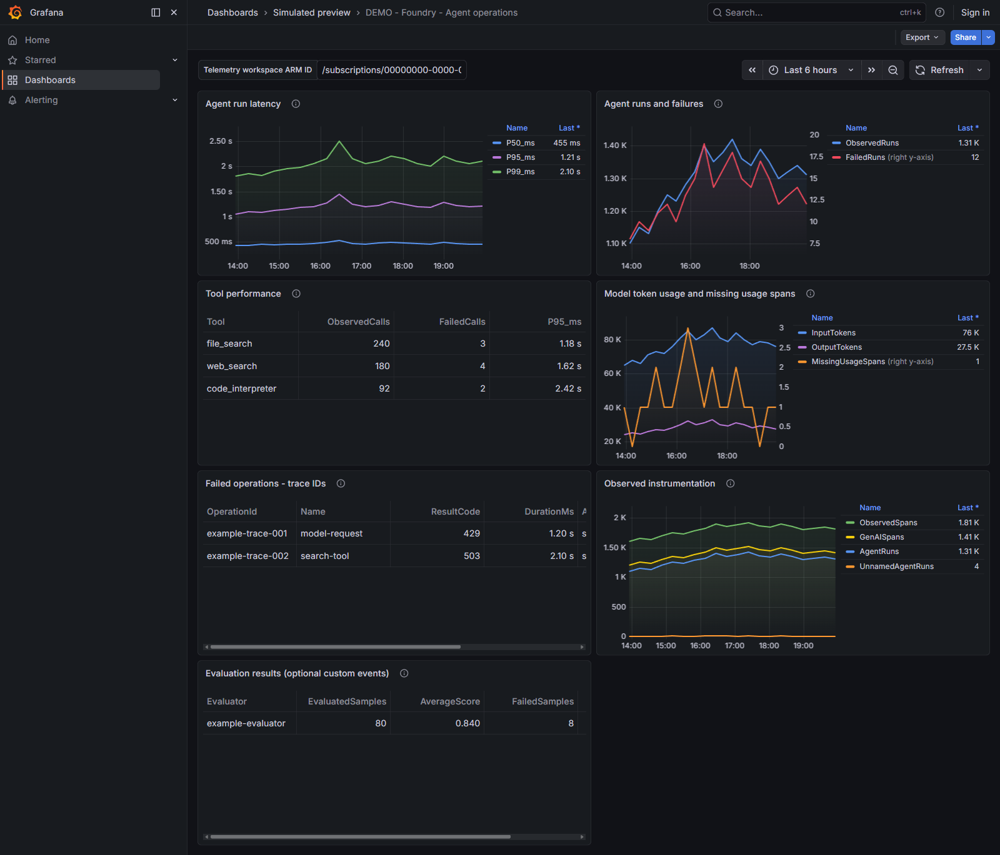
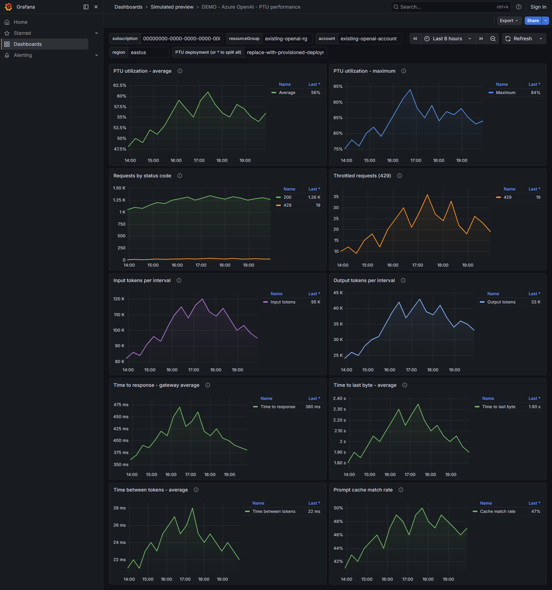
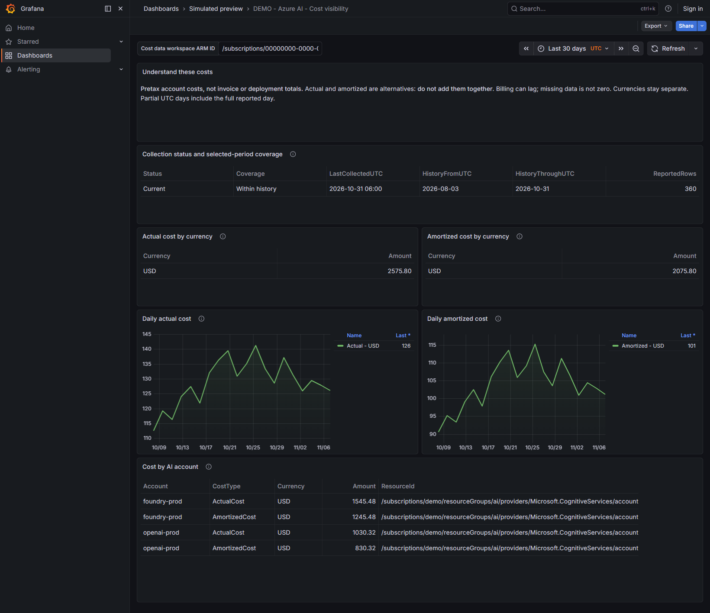

# Azure AI Observatory

**Foundry agents · OpenAI PTUs · Cost visibility**

Monitoring-only starter for **Microsoft Foundry** and **Azure OpenAI provisioned throughput (PTUs)**, with separate dashboards on shared **Azure Managed Grafana + Azure Monitor + Application Insights / Log Analytics** infrastructure.

**Choose your deployment:** [Terraform](#deploy-with-terraform) · [Bicep](#deploy-with-bicep)

## Dashboards

These are **actual Grafana screenshots with simulated data**, not results from an Azure deployment. The deployed dashboards use Azure Monitor and Log Analytics; the Foundry and PTU screenshots do not show every panel.

### Foundry agent operations



### Azure OpenAI PTU performance



### Azure AI costs



## Deploy to Azure

Choose **Terraform or Bicep**: both deploy Azure monitoring resources, roles, alerts, Grafana's data source, and dashboards. Either can also deploy the optional PowerShell Azure Function and cost dashboard. Neither path requires Python to deploy. Use only one tool for a given deployment; they do not share state or ownership.

**Before deploying:** have Azure CLI, an Azure identity allowed to create resources and assign roles, existing account details and regions, PTU deployment names, a Grafana admin object ID, and an alert email. The Bicep path uses PowerShell 7 and Azure CLI for Function publishing and Grafana's data-plane API; Terraform uses PowerShell 7 and Azure CLI when the cost Function is enabled.

Neither path has **been validated in a live Azure subscription**. Start in nonproduction and check permissions, metric availability, ingestion, dashboards, and alert delivery with the [acceptance checklist](docs/setup.md#acceptance-checklist).

### Deploy with Terraform

Install Terraform 1.7+ and configure protected, locked remote Terraform state for real environments; state can contain sensitive values. The [Terraform guide](docs/terraform.md) covers both stages and access requirements.

**1. Create Azure monitoring resources**

Copy `terraform/azure/example.tfvars.example` to `terraform/azure/local.tfvars` and replace its placeholders. Set `enable_cost_pipeline = true` to deploy the optional cost collector. If PTU metric support is not yet confirmed, set `enable_ptu_alerts = false` initially; enable it after [metric discovery](docs/setup.md#metric-discovery).

```powershell
az login
az account set --subscription "<subscription-id>"
terraform -chdir=terraform\azure init
terraform -chdir=terraform\azure plan -var-file=local.tfvars
# Review the plan and expected Azure charges before applying:
terraform -chdir=terraform\azure apply -var-file=local.tfvars
terraform -chdir=terraform\azure output
```

**2. Deploy and configure Grafana dashboards**

Copy `terraform/grafana/example.tfvars.example` to `terraform/grafana/local.tfvars`. Fill in `grafana_endpoint` and `dashboard_defaults.monitoring_workspace_resource_id` from the Azure outputs, plus the real subscription, Foundry account, and PTU account/deployment. Set `enable_cost_dashboard = true` if you enabled the cost pipeline. If agent telemetry already lives in another workspace, set `telemetry_workspace_resource_id` and grant Grafana access as described in the [deployment guide](docs/terraform.md#2-configure-the-grafana-stage).

After the Grafana Admin role has propagated, use the same signed-in identity to apply the second stage:

```powershell
$env:GRAFANA_AUTH = az account get-access-token --resource https://dashboard.azure.com --query accessToken -o tsv
if ($LASTEXITCODE -ne 0 -or -not $env:GRAFANA_AUTH) { throw "Could not obtain a Grafana Entra token" }
terraform -chdir=terraform\grafana init
terraform -chdir=terraform\grafana plan -var-file=local.tfvars
# Review the plan before applying:
terraform -chdir=terraform\grafana apply -var-file=local.tfvars
terraform -chdir=terraform\grafana output dashboard_urls
Remove-Item Env:\GRAFANA_AUTH
```

### Deploy with Bicep

Install Azure CLI with Bicep and PowerShell 7. Copy `infra/main.example.bicepparam` to `infra/main.local.bicepparam` and replace its placeholders. Set `enableCostPipeline = true` for the optional Function and cost dashboard. Use real account regions and deployment names in the dashboard defaults.

```powershell
az login
az account set --subscription "<subscription-id>"
# Create the monitoring resource group first, if it does not exist:
az group create --name "<monitoring-rg>" --location "<region>"
pwsh -NoProfile -File .\scripts\deploy_bicep.ps1 -SubscriptionId "<subscription-id>" -ResourceGroup "<monitoring-rg>" -ParametersFile .\infra\main.local.bicepparam -WhatIf
# Review the what-if output and expected Azure charges before deploying:
pwsh -NoProfile -File .\scripts\deploy_bicep.ps1 -SubscriptionId "<subscription-id>" -ResourceGroup "<monitoring-rg>" -ParametersFile .\infra\main.local.bicepparam
```

The helper deploys the Bicep template, publishes the Function when enabled, and configures Grafana using a short-lived Entra token. See the [Bicep guide](docs/bicep.md) for permissions, dashboard defaults, reruns, and the important difference between disabling a feature and deleting its Azure resources.

Existing Foundry/OpenAI accounts and deployments are monitored, not created or resized. Agent charts require real instrumented telemetry; the cost collector runs daily and billing data can lag. Both paths can grant an Entra group read-only Grafana Viewer access, which is **not a data-isolation boundary**. See [business-user access](docs/terraform.md#business-user-access) and [cost interpretation](docs/costs.md).

## What is included

| Area | Included | Prerequisite / boundary |
| --- | --- | --- |
| Foundry estate | Accessible accounts, projects, and ML workspace inventory | Resource Graph returns only resources visible to the Grafana identity |
| Foundry agents | Run latency percentiles, failures, tool performance, token usage, trace IDs, observed telemetry counts | Application Insights instrumentation matching the documented contract |
| Foundry model usage | OpenAI requests and inference tokens on a selected Foundry account | OpenAI-specific metrics; not a universal endpoint for all Foundry model providers |
| Evaluations | Optional evaluator score / pass-fail dashboard | Publish evaluation events explicitly; this repo does not run evaluations |
| Azure OpenAI PTUs | Utilization V2, requests by status, 429s, input/output tokens, gateway latency, cache hit rate | Existing provisioned deployments and supported metric definitions |
| Alerting | Per-deployment PTU utilization and 429 metric alerts; opt-in agent failure-rate, p95 latency, and heartbeat alerts | Agent rules require matching telemetry; heartbeat also requires guaranteed expected traffic |
| Cost visibility | Optional Function-fed dashboard for actual and amortized account-attributed pretax costs; current PTU allocation and an optional account-scoped budget | Billing can be delayed; costs are not invoice totals, reservation coverage, or deployment-level spend |
| Operations | Terraform or Bicep deployment, reproducible dashboard generator, queries, telemetry demo, CI, troubleshooting runbooks | No Azure credentials needed to validate source locally |

This is a foundation for broad Foundry observability, **not a claim that every Foundry feature emits telemetry automatically**. See [coverage and architecture](docs/architecture.md) for costs, safety, evaluations, dependencies, and gaps.

## Existing alternatives

Microsoft already provides several adjacent options: the [Foundry Agent Monitoring Dashboard](https://learn.microsoft.com/azure/foundry/observability/how-to/how-to-monitor-agents-dashboard), the [Azure Monitor Agents view](https://learn.microsoft.com/azure/azure-monitor/app/agents-view), and an [Azure Managed Grafana Foundry dashboard](https://learn.microsoft.com/azure/managed-grafana/azure-ai-foundry-dashboard). These are worth evaluating first if you primarily need Microsoft's built-in agent or Foundry views.

This repository combines deployable Terraform or Bicep monitoring infrastructure and Grafana dashboards with agent telemetry, Azure OpenAI PTU service metrics, and optional account-attributed costs.

## Repository layout

```text
infra/       Bicep monitoring resources, access, alerts, and optional cost pipeline
terraform/   Native Azure resources and Grafana data source/dashboard deployment
dashboards/  Importable Foundry, agent, PTU, and optional cost dashboards
demo/        Local-only Grafana preview using clearly labeled simulated data
docs/images/ Actual Grafana screenshots with simulated data
queries/     Workspace KQL and Azure Resource Graph inventory query
function/    Optional scheduled Azure Functions cost collector
scripts/     Bicep/Grafana deployment helper and optional dashboard generators
examples/    Synthetic OpenTelemetry example (no model calls)
docs/        Setup, coverage, telemetry contract, and alert runbooks
tests/       Dashboard structure, units, filtering, and reproducibility checks
```

## Developer validation

Python is used for these optional offline tests, dashboard generation, and the sample telemetry application—not for either deployment path:
```powershell
python .\scripts\build_dashboards.py
python .\scripts\build_demo_dashboards.py
python -m unittest discover -s .\tests -v
az bicep build --file .\infra\main.bicep --outfile "$env:TEMP\ai-observability-main.json"
az bicep build-params --file .\infra\main.example.bicepparam --outfile "$env:TEMP\ai-observability-params.json"
```

These commands do not deploy anything. CI also validates and mock-tests both Terraform stages. Offline checks do not replace live Azure metric, KQL, RBAC, and dashboard verification; use the [acceptance checklist](docs/setup.md#acceptance-checklist).

## Security and cost defaults

- Managed identity for Grafana; scoped read roles, no model management permissions.
- Application Insights local authentication disabled; telemetry senders need Entra authentication and the **Monitoring Metrics Publisher** role on the Application Insights resource. Either deployment path can assign this role to explicitly listed principals.
- Public endpoints with Entra authorization in this starter. Private endpoints and Azure Monitor Private Link require a separate networking design; see setup.
- No prompt, response, tool-argument, or exception-content capture in the demo.
- Log retention defaults to 30 days with a 1 GB daily ingestion cap. A cap can cause gaps and is **not** a complete spending limit.
- The opt-in cost collector receives **Cost Management Reader for the subscription**, even though it queries only the selected account IDs. Grafana Viewer access is read-only, not a data-isolation boundary.
- Grafana hosting, telemetry ingestion/retention, alert rules, Function execution, and storage can incur charges. PTU deployment and reservation charges remain separate.

For repository security checks and private vulnerability reporting, see [SECURITY.md](SECURITY.md).

## References

- [Azure OpenAI monitoring metrics](https://learn.microsoft.com/azure/foundry/openai/monitor-openai-reference)
- [Operating provisioned deployments](https://learn.microsoft.com/azure/foundry/openai/how-to/provisioned-get-started)
- [Foundry agent tracing](https://learn.microsoft.com/azure/foundry/observability/concepts/trace-agent-concept)
- [Application Insights agent monitoring and Grafana views](https://learn.microsoft.com/azure/azure-monitor/app/agents-view)
- [Azure Managed Grafana Azure Monitor integration](https://learn.microsoft.com/azure/managed-grafana/how-to-connect-azure-monitor)
- [Azure Cost Management query API](https://learn.microsoft.com/rest/api/cost-management/query/usage)
- [Azure Functions Flex Consumption](https://learn.microsoft.com/azure/azure-functions/flex-consumption-plan)

<details>
<summary>Optional local layout preview with simulated data</summary>

This preview does not deploy to Azure or validate live data. With Docker Compose installed, run `docker compose -f .\demo\docker-compose.yml up -d`, open [Grafana at localhost:3100](http://127.0.0.1:3100), and open the **Simulated preview** folder. The preview listens on localhost with anonymous Viewer access; never expose it publicly. Stop it with `docker compose -f .\demo\docker-compose.yml down`.

</details>
