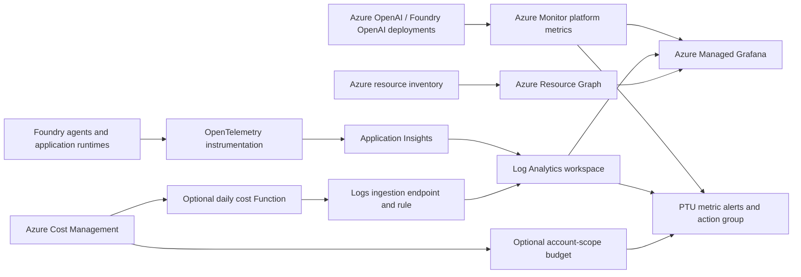

# Coverage and architecture

## Two independent monitoring tracks

**Foundry:** inventory and agent operations, with OpenAI usage panels where relevant. Telemetry is read from a selected Log Analytics workspace. Existing telemetry workspaces can be granted Grafana access without changing agent configuration. The optional new Application Insights resource is a telemetry destination, not a connection automatically attached to every project.

**PTUs:** service metrics read directly from `Microsoft.CognitiveServices/accounts`, filtered/split by `ModelDeploymentName`. This works independently of Foundry agent instrumentation, and a PTU account may be entirely separate from your Foundry account. PTUs consumed by a Foundry agent still belong to the backing model deployment.

No custom exporter is needed for PTU utilization. In particular, **utilization V2 and cache match rate are not exportable through diagnostic settings** in the documented metric reference; querying them in Azure Monitor preserves the native metrics and dimensions.

## What "all things Foundry" means here

| Concern | Coverage / extension |
| --- | --- |
| Agent latency, failures, tool execution | Included when spans match the contract |
| Model/token usage | Included for OpenAI platform metrics and instrumented model spans |
| Other model providers, serverless or managed compute | Add their supported Azure metric namespaces or runtime instrumentation; do not reuse OpenAI metric names |
| Safety and quality | Optional evaluation-event panel; wire actual evaluators and provider-specific safety telemetry separately |
| Retrieval quality / search latency | Agent tool spans show client-observed latency; add Azure AI Search metrics and evaluation results for deeper diagnosis |
| Agent memory, Cosmos DB, Storage | Add resource-specific dashboards and scoped read permissions for the dependencies you actually use |
| Hosted-agent containers / infrastructure | Add runtime telemetry; platform metrics are not automatically a substitute for application instrumentation |
| Quota, PTU allocation, capacity availability | Azure management-plane inventory/capacity queries; utilization alone does not measure available regional capacity |
| Billing, reservations, budgets | Optional account-attributed actual/amortized cost dashboard and account-scope budget; invoice and reservation reporting remain separate |
| Multi-project attribution | Retain project/resource identity attributes and add filters or separate workspaces |

Do not treat missing spans, missing metric definitions, or missing evaluation events as zero errors. The observed-instrumentation panel distinguishes generic application spans from recognized agent spans, but does not calculate a coverage percentage. An entirely silent workspace still needs an independent telemetry-heartbeat alert.

## Metric interpretation

- Percentages use Grafana's 0-100 `percent` unit, not a 0-1 fraction.
- Request/token totals are **per displayed interval**, not requests/second or tokens/second.
- Time to response is service/gateway-observed responsiveness, not client-perceived end-to-end agent latency.
- Native metric averages are not request-level p95/p99. Agent p95/p99 are computed from retained trace spans; sampling can bias them.
- Pair latency with prompt/output token volume, cache hits, concurrency, retries, and tools before declaring a performance regression.
- HTTP 429 can reflect capacity, quotas, or other throttling conditions. Confirm the deployment and error before recommending more PTUs.
- Select an explicit PTU deployment in the PTU dashboard. `*` splits all deployments, including non-PTU deployments in request/token panels.

## Permissions and boundaries

The Grafana managed identity gets Monitoring Reader on each configured AI account and Log Analytics Reader on each configured telemetry workspace. It does not get subscription-wide Owner/Contributor or data-plane model invocation privileges. Resource Graph inventory remains restricted by its actual resource access; grant scoped Reader separately for additional projects/hubs/dependencies you want inventoried.

The optional cost collector uses a separate identity with subscription-wide Cost Management Reader. It queries only explicitly configured account resource IDs, but the role is broader than those filters. The dashboard reads completed snapshots from the monitoring workspace; actual and amortized values are separate, pretax, currency-specific, and may omit reservation purchases, shared charges, tax, and child-resource costs. They are not invoice totals. Billing delay, rolling-history limits, ingestion caps, storage, and Function costs are described in [cost collection](costs.md).

Infrastructure deployment requires resource creation and role-assignment permissions in the monitoring resource group and all target resource groups, potentially in multiple subscriptions within one Entra tenant. Dashboard access is a separate Grafana role assigned to users/groups. Data-source permissions are not inherited from a dashboard viewer's Azure resource access: use workspace isolation and Grafana access policies deliberately.

The public-endpoint starter is not an enterprise private-network baseline. It does not modify existing Foundry accounts, expose their inference endpoints, or deploy an agent.
