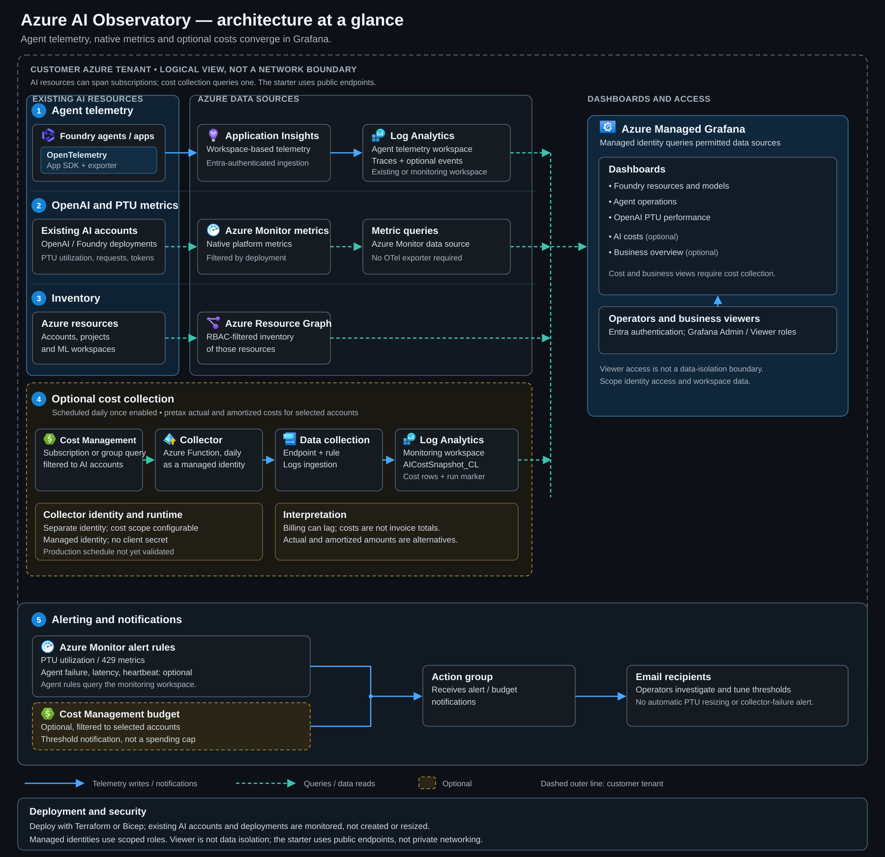

# Coverage and architecture

[View full size](images/azure-observability-architecture-dark.svg)

The diagram is a logical view, not a live resource inventory. Dashed boxes identify optional features, not private networking. Azure service icons are from the [Microsoft Azure Architecture Center](https://learn.microsoft.com/azure/architecture/icons/). The data flows are:

1. Agents and applications configured with OpenTelemetry send traces through Application Insights to an existing or new Log Analytics workspace. Evaluation events require separate instrumentation. The starter deploys neither the application instrumentation nor an OpenTelemetry Collector. PTU metrics, resource inventory, and cost collection use Azure-native services. Grafana reads the telemetry workspace.
2. Grafana queries native Azure Monitor metrics for the selected OpenAI account and deployments, independently of agent instrumentation.
3. Grafana queries Azure Resource Graph for an inventory of accounts, projects and ML workspaces, limited by its managed identity's access. Resource Graph does not index model deployments, so allocated PTUs are not read from it.
4. If enabled, an Azure Function on a daily timer queries Cost Management for selected account IDs and sends actual and amortized snapshots through a data collection endpoint and rule to the monitoring workspace. It signs in as a user-assigned managed identity (no client secret, no GitHub or other external scheduler). This is the only data that needs a collector: Grafana's managed identity cannot query Cost Management, whereas it reads metrics, logs and Resource Graph directly. The Function also uses storage, sends its telemetry to Application Insights, and sends storage read diagnostics to the monitoring workspace. Grafana reads complete snapshots for the cost and business dashboards. Isolated labs exercised the collector's code and least-privilege role, but the scheduled run of a deployed Function was not observed because a tenant policy blocked publishing it (see [cost collection](costs.md#tenants-that-force-storage-public-access-off)).
   - **4b (separate, opt-in).** Instead of, or in addition to, the collector, Grafana's Infinity data source can query the Cost Management Query API live for billed cost. There is no Function, storage or Log Analytics copy. It signs in as a service principal with a **client secret stored in Grafana**, so unlike the collector it is not secretless and the secret must be rotated. See [direct queries with Infinity](costs.md#direct-cost-management-queries-with-infinity-opt-in).
5. PTU metric alerts and optional agent log alerts use an action group for email. An independently enabled, account-filtered budget can use the same action group. Agent alerts query the **new monitoring workspace**, even when Grafana reads agent telemetry from an existing workspace. Separately, the Infinity path can add a Grafana-managed alert rule that fires when the data source cannot query Cost Management, for example because its secret failed. It notifies a Grafana contact point that you create and route, not the action group, and it is not an advance expiry warning (see [get alerted when the secret fails](costs.md#get-alerted-when-the-secret-fails)).

Grafana and the cost collector use separate managed identities. The collector defaults to a subscription-wide Cost Management Reader role despite its account filters; optional resource-group query modes use either separately managed grants or deployment-managed scoped custom roles. The optional Infinity path uses a service principal with a client secret instead. Viewer access is not a data-isolation boundary. For the public endpoint, cost, and operational limitations, see [permissions and boundaries](#permissions-and-boundaries) and [cost collection](costs.md).

## Two independent monitoring tracks

**Foundry:** inventory and agent operations, with OpenAI usage panels where relevant. Telemetry is read from a selected Log Analytics workspace. Existing telemetry workspaces can be granted Grafana access without changing agent configuration. The optional new Application Insights resource is a telemetry destination, not a connection automatically attached to every project.

**PTUs:** service metrics read directly from `Microsoft.CognitiveServices/accounts`, filtered/split by `ModelDeploymentName`. This works independently of Foundry agent instrumentation, and a PTU account may be entirely separate from your Foundry account. PTUs consumed by a Foundry agent still belong to the backing model deployment.

No custom exporter is needed for PTU utilization. In particular, **utilization V2 and cache match rate are not exportable through diagnostic settings** in the documented metric reference; querying them in Azure Monitor preserves the native metrics and dimensions.

## What "all things Foundry" means here

| Concern | Coverage / extension |
| --- | --- |
| Agent latency, failures, tool execution | Included when spans match the contract |
| Model/token usage | Included for OpenAI platform metrics and instrumented model spans |
| Other model providers, serverless or managed compute | Add their supported Azure metric namespaces or runtime instrumentation; do not reuse OpenAI metric names |
| Safety and quality | Optional evaluation-event panel; wire actual evaluators and provider-specific safety telemetry separately |
| Retrieval quality / search latency | Agent tool spans show client-observed latency; add Azure AI Search metrics and evaluation results for deeper diagnosis |
| Agent memory, Cosmos DB, Storage | Add resource-specific dashboards and scoped read permissions for the dependencies you actually use |
| Hosted-agent containers / infrastructure | Add runtime telemetry; platform metrics are not automatically a substitute for application instrumentation |
| Quota, PTU allocation, capacity availability | Not available from Azure Monitor or Resource Graph. Read allocated PTUs from the deployment (portal, `az cognitiveservices account deployment show` or ARM) and quota from Azure Quotas; utilization alone does not measure available regional capacity |
| Billing, reservations, budgets | Optional account-attributed actual/amortized cost dashboard and account-scope budget; invoice and reservation reporting remain separate |
| Multi-project attribution | Retain project/resource identity attributes and add filters or separate workspaces |

Do not treat missing spans, missing metric definitions, or missing evaluation events as zero errors. The observed-instrumentation panel distinguishes generic application spans from recognized agent spans, but does not calculate a coverage percentage. An entirely silent workspace still needs an independent telemetry-heartbeat alert.

## Metric interpretation

- Percentages use Grafana's 0-100 `percent` unit, not a 0-1 fraction.
- Request/token totals are **per displayed interval**, not requests/second or tokens/second.
- Time to response is service/gateway-observed responsiveness, not client-perceived end-to-end agent latency.
- Native metric averages are not request-level p95/p99. Agent p95/p99 are computed from retained trace spans; sampling can bias them.
- Pair latency with prompt/output token volume, cache hits, concurrency, retries, and tools before declaring a performance regression.
- HTTP 429 can reflect capacity, quotas, or other throttling conditions. Confirm the deployment and error before recommending more PTUs.
- Select an explicit PTU deployment in the PTU dashboard. `*` splits all deployments, including non-PTU deployments in request/token panels.

## Permissions and boundaries

The Grafana managed identity gets Monitoring Reader on each configured AI account and Log Analytics Reader on each configured telemetry workspace. It does not get subscription-wide Owner/Contributor or data-plane model invocation privileges. Resource Graph inventory remains restricted by its actual resource access; grant scoped Reader separately for additional projects/hubs/dependencies you want inventoried.

Anyone with Log Analytics Reader on the telemetry workspace, including Grafana's managed identity, can read every table in it, among them `AppGenAIContent`, which holds prompt and response structure (and the text itself if content recording is enabled). See [agent telemetry](telemetry.md#appgenaicontent-is-a-data-protection-surface).

The optional cost collector uses a separate identity. Its default subscription-wide Cost Management Reader role is broader than its account filters; resource-group query modes can use separately managed or deployment-managed group-scoped grants, but filters still do not constrain those grants. Switching scope does not automatically remove every existing assignment. The dashboard reads completed snapshots from the monitoring workspace; actual and amortized values are separate, pretax, currency-specific, and may omit reservation purchases, shared charges, tax, and child-resource costs. They are not invoice totals. Billing delay, rolling-history limits, ingestion caps, and storage and Function costs are described in [cost collection](costs.md).

Infrastructure deployment requires resource creation and role-assignment permissions in the monitoring resource group and all target resource groups, potentially in multiple subscriptions within one Entra tenant. Dashboard access is a separate Grafana role assigned to users/groups. Data-source permissions are not inherited from a dashboard viewer's Azure resource access: use workspace isolation and Grafana access policies deliberately.

The public-endpoint starter is not an enterprise private-network baseline. It does not modify existing Foundry accounts, expose their inference endpoints, or deploy an agent.
